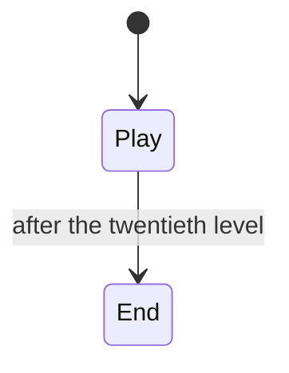

# 3. Box Jump

Game #3 of lessmilk.com (Thomas Palef, 2014), in Phaser 1.1.3: 185 lines
of JavaScript in four files, 20 of which are the map of the twenty levels.
The port is in `games/box_jump/` (207 lines). The student's version
(`box_jump/main.atm`) has no written analysis; this one is ours.

The game: a box runs on a line, from left to right; SPACE jumps, and the
box turns half a turn in the air. A cube that touches it is a death: a
burst of particles, and the box starts the level again. At the right end,
the next level; after the twentieth, the deaths.

## The flow



Within Play, the levels follow each other when the box passes `w - 60`,
and a death starts the level again, with no change of state.

## The update, in order

The whole game is in one `update`, whose steps depend on each other in
order: `collide` with the line sets `touching.down`, which decides the
jump, which sets the velocity; the test of the end of the level may load
the next one and put the box back at the start, before the gravity is set
and the fall is tested; the overlap with the cubes comes last. The port
keeps these steps in one task, in the same order:

```
do :play {
    loop on :update {               ;; before the first jump
        collide(body, lbody)
        val jumped = cursor_down(keys, 'SPACE') && body.touching.down
        if jumped { jump() ; set body.vx = 170 ; ... }
        if rest(jumped) == :end { escape :play }
        until jumped
    }
    loop on :update {               ;; after it: the box runs
        collide(body, lbody)
        if cursor_down(keys, 'SPACE') && body.touching.down { jump() }
        if rest(true) == :end { escape :play }
    }
}
```

The flag `start` of the original, 0 until the first jump, is which of the
two loops runs. A first attempt split the steps among tasks awaiting
`:update`; it read `touching.down` before `collide` set it, because the
tasks of a block awake before its body ([compiler.md](../compiler.md)).
What depends on order within a frame stays in one sequence; what happens
at another point of the frame of Phaser has its own phase.

## Hits and lifetimes

A hit is an `await` in its own task, at the end of the update:

```
loop {
    await :overlap until player.alive && overlap_any(body, :cube)
    set player.alive = false
    emitter_start(emitter, true, 300, nil, 8)
    ...
    init_player()
}
```

`alive` stays a flag: it is the `alive` of Phaser's sprite, which the
arcade physics reads (a sprite that is not alive is not in the quadtree),
and the update sets it again when the box lands.

The cubes of a level are tasks in a pool; a cube grows with a `Motion` of
its scale, and its body grows with it. The level ends with `abort cubes`.
A particle is a task too, which lives its 300 ms; in the original, the 200
particles are made once, and recycled with flags.

## The rotation of a jump

Each jump starts a tween of half a turn, and keeps it in `this.rotation`;
when the box starts again, it pauses that tween. Only the last one: a tween
of an earlier jump, if still running, goes on. The port keeps this as it
is: each jump spawns a `Motion` with a control table, and `init_player`
stops the last one.
