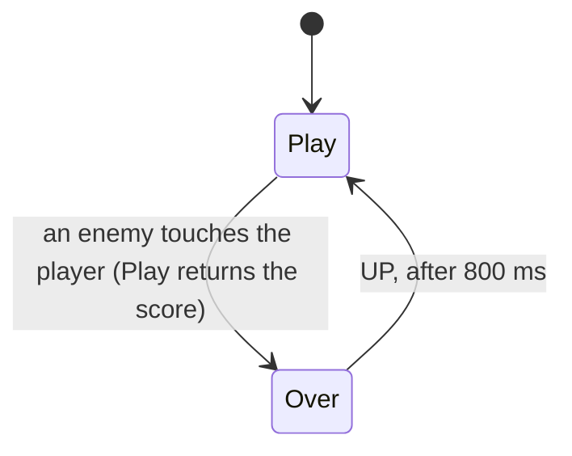

# 1. Run!

Game #1 of lessmilk.com (Thomas Palef, 2014), in Phaser 1.1.3: 144 lines of
JavaScript in four files (`game.js`, `load.js`, `play.js`, `over.js`).
The port is in `games/run/` (139 lines). This document follows the
analysis of Jéssica Oliveira in her port
([`Run/README.md`](https://github.com/jessicacoliveira/atmos-lessmilk/tree/3e24458/Run)),
in Portuguese, translated and adapted to this port.

The game: the player moves a robot with the arrows; an enemy crosses the
screen every 500 ms; a point every second; an enemy that touches the robot
ends the game; UP plays again, after 800 ms.

## The flow of the screens



In Phaser, the flow is spread over three states (`Load`, `Play`, `Over`),
each of which starts the next one with `game.state.start`: `Load` at the
end of its `create`, `Play` in the callback of the overlap, `Over` in its
`update`. The score survives the change of state in a global. As the
student puts it, the order of the screens is not written anywhere: it is
rebuilt by following the jumps from file to file. It is continuation
passing: the end of each long activity carries what comes next.

In the port, the flow is read in sequence, and the only jump is the loop
(`main.atm`):

```
loop {
    set score = await Play()
    await Over(score)
}
```

## Play

```
task Play () {
    val keys = Cursor()
    ;; the player: a sprite with a body, in the world
    pin enemies = tasks(60)
    spawn { loop on :rl.draw { ... } }                  ;; the drawing
    spawn { loop on :pre { sprite_update(player) } }    ;; its animation
    spawn {                                             ;; the label fades,
        await :update until cursor_down(keys, 'UP')     ;; at the first UP
        await Motion(label_keys, [alpha=0], 800)
    }
    spawn { loop on :update { ...arrows -> velocity... } }
    spawn {                                             ;; an enemy every
        await :update                                   ;; 500 ms
        loop {
            spawn @enemies Enemy(new_enemy())
            await Wait(500)
        }
    }
    spawn {                                             ;; a point every
        await :update                                   ;; second
        loop {
            set score += 1
            await Wait(1000)
        }
    }
    await :overlap until overlap_any(body, :enemy)      ;; the end
    score
}
```

An enemy (`enemy.atm`) is a task in the pool, whose life is its body:

```
task Enemy (kind, x, y, tox, toy) {
    ...
    par :any {
        await Motion(spr, [x=tox, y=toy], 3000)
        await false
    } with {
        await :pre until !in_world(spr)     ;; outOfBoundsKill
    } with {
        loop on :pre { sprite_update(spr) }
    }
}
```

## The patterns

### Comparisons with the clock become awaits

Phaser 1.1.3, used by nine of the twelve games, has no timers
(`game.time.events` came later). Run! keeps the time of the next event in a
field and compares it with the clock in every update:

```js
if (this.game.time.now > this.enemyTime)
    this.newEnemy();            // which sets this.enemyTime = now + 500
```

The student's figure shows the jumps: when the time is up, `update` calls
`newEnemy`, which moves the time ahead and returns, and the next frame
starts `update` from the top again; since `enemyTime` starts at 0, the
first test is already true. The behavior is spread over `create`,
`update`, and `newEnemy`. In the port, it is one loop, in the order in
which it happens:

```
loop {
    spawn @enemies Enemy(new_enemy())
    await Wait(500)
}
```

The same holds for `scoreTime` (a point every second), for `time` in Over
(UP is ignored for 800 ms), and for the flag `firstKey` (the label fades
once): four control variables in the original, none in the port
([state.md](../state.md)).

### Lifetime

The student traced the life of an enemy in Phaser: `createMultiple` makes
30 dead sprites in `create`; `newEnemy` takes the first one that does not
exist (`getFirstExists(false)`) and `reset`s it, which sets three flags
(`exists`, `alive`, `visible`); `outOfBoundsKill` makes the engine call
`kill` when it leaves the world, which clears them. To be born and to die
is to change booleans in an object that never leaves its group. The
player never dies: the callback of the overlap only changes the state.
`state.start` takes the objects off the display list but destroys nothing:
they live in `this.player` and `this.enemies1` until the next `create`
assigns new ones. No one calls `destroy`.

She also found what accumulates: each round adds two sounds to
`game.sound._sounds` (one made in `Play.create` and never played, one in
`Over.create`), which is never emptied in 1.1.3.

In the port, a lifetime is a block. An enemy is a task in the pool
`enemies`; when it leaves the world, its `await` ends, the task ends, its
`defer` removes its body, and it leaves the pool. When `Play` ends, its
pool, its spawns, and its body end with it. Sounds are loaded once, by
path.

A detail that the port had to keep: Phaser does not stop the tween of an
enemy that dies. A recycled sprite can have its old tween still moving it
for a few frames, under the new one, which wins because it updates later.
In the port, the tween dies with the task, and the result is the same.

### Dispatch hierarchy

In Phaser, each frame reaches each object through the engine: the tweens,
the animations, the bodies, the test of the bounds, the drawing. Run!
writes none of this dispatch; it is all on the side of the framework, and
its order is only in the source of Phaser (the student checked that it
changed between 1.1.3 and CE 2.20.2). The port has to make that order
explicit once (`lib/game.atm`), since the same game depends on it: an
enemy collides where it was drawn in the last frame, and a tween started
in an update moves two frames later ([fidelity.md](../fidelity.md)). Each
entity then awaits the phase it reacts to (`:pre`, `:update`,
`:overlap`), and no one forwards anything.

### Signaling

In the original, no entity talks to another: `update` calls
`physics.overlap`, whose callback changes the state right there. The
student's port signals the hit with an event (`emit @player :dead`), which
ends the robot, whose end awakes `Play`. Here the hit is the end of
`Play` itself: `await :overlap until overlap_any(body, :enemy)`. The
physics is one pass over the bodies; the games with collisions between
many entities will need them as events.
